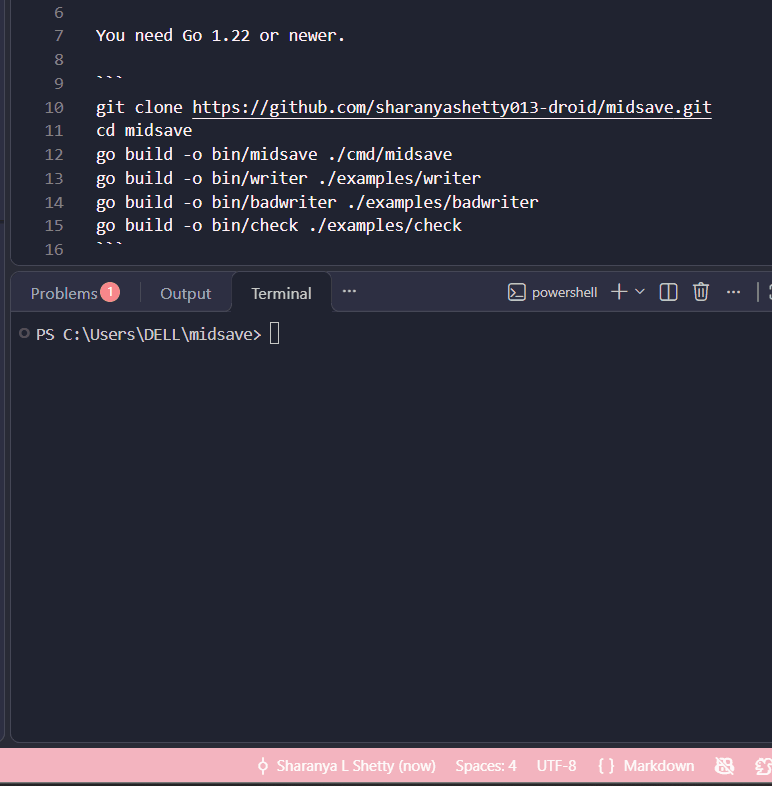

<div align="center">

# midsave

### Your app saves data. What happens if it dies *mid-save*?

**midsave pulls the plug on your app hundreds of times and tells you exactly when your data breaks.**




</div>

## The problem

You pay ₹500. Your phone dies halfway through.
The money left your account. The shop never got it.

That's a **crash in the middle of a save**, and almost nobody tests for it, because testing it by hand means crashing your app over and over and checking the data every time.

**midsave does that for you. Automatically. In one command.**

## See it catch a bug

Same checker. Two apps. One is safe, one has a hidden bug.

<table>
<tr>
<th>Safe app</th>
<th>Buggy app</th>
</tr>
<tr>
<td>

```
run 1:  ok
run 2:  ok
run 3:  ok
run 4:  ok
run 5:  ok
run 6:  ok
run 7:  ok
run 8:  ok
run 9:  ok
run 10: ok

0 of 10 runs lost or broke data
```

</td>
<td>

```
run 1:  ok
run 2:  BROKEN
run 3:  BROKEN
run 4:  ok
run 5:  BROKEN
run 6:  BROKEN
run 7:  ok
run 8:  BROKEN
run 9:  BROKEN
run 10: BROKEN

7 of 10 runs lost or broke data
```

</td>
</tr>
</table>

The buggy app writes each number in two steps. Kill it in between and you get **half a number** on disk: a *torn write*.

midsave also tells you **exactly where** it broke, and how to replay it:

```
seed: 42
run 2: BROKEN (killed after 1.187s): BROKEN at line 24 found: 2

replay these exact crash times with: --seed 42
```

The app was writing `24`, but only the `2` reached the disk.

## How it works

```
        ┌──────────────┐
        │ start app    │
        └──────┬───────┘
               ▼
        ┌──────────────┐
        │ wait random  │   ← could be 0.2s, could be 2s
        └──────┬───────┘
               ▼
        ┌──────────────┐
        │ kill it      │   ← no warning, no cleanup
        └──────┬───────┘
               ▼
        ┌──────────────┐
        │ run checker  │   ← is the data still okay?
        └──────┬───────┘
               ▼
          ok or BROKEN
               │
               └── repeat × N
```

You bring a **checker**: any program that exits `0` if the data is fine, and anything else if it's broken. Only you know what "correct" means for your app, so you decide.

## Download

Grab the latest version from the [Releases page](https://github.com/sharanyashetty013-droid/midsave/releases/latest):

| Your computer | Download |
|---|---|
| Windows (most PCs) | `midsave_x.x.x_windows_amd64.zip` |
| Mac (Apple M1/M2/M3) | `midsave_x.x.x_darwin_arm64.tar.gz` |
| Mac (Intel) | `midsave_x.x.x_darwin_amd64.tar.gz` |
| Linux | `midsave_x.x.x_linux_amd64.tar.gz` |

Unzip it and run `midsave --app <your app> --check <your checker>`.

> **Note:** midsave isn't code-signed yet, so Windows may show "Windows protected your PC". Click **More info → Run anyway**. On Mac, right-click → **Open** the first time.

## Try it in 60 seconds

```bash
git clone https://github.com/sharanyashetty013-droid/midsave.git
cd midsave

go build -o bin/badwriter.exe ./examples/badwriter
go build -o bin/check.exe ./examples/check

go run ./cmd/midsave --app bin/badwriter.exe --check bin/check.exe --clean data.txt --runs 10
```

> On Mac/Linux, drop the `.exe`.

| Flag | What it does | Default |
|---|---|---|
| `--app` | the program to crash-test | required |
| `--check` | the program that checks the data | required |
| `--clean` | file to delete before each run | none |
| `--runs` | how many times to crash it | `10` |
| `--seed` | replay the exact same crash times | random |

## Doesn't this already exist?

Sort of, but not for everyday developers.

| | Who it's for | Windows? | Setup |
|---|---|---|---|
| CrashMonkey | file system researchers | No | heavy |
| ALICE / Pathfinder | academic research | No | heavy |
| LazyFS | storage experts | No | FUSE + config |
| Jepsen | distributed systems experts | No | heavy |
| **midsave** | **any developer** | Yes | **one command** |

## Limits

Killing a process is not the same as a real power cut. Data your app already handed to the OS still reaches the disk when only the process dies. So **v0.1 catches app-level bugs**:

- data written in more than one step (torn writes)
- data still sitting in your app's memory
- unsafe file replacing

Simulating a true power cut is on the roadmap.

## Roadmap

- [x] `--seed` to replay any crash exactly
- [x] report *which* line broke and why
- [ ] JSON output
- [ ] GitHub Action to crash-test on every push
- [ ] SQLite + Postgres examples
- [ ] power-cut mode

## Contributing

New to open source? Issues labelled **`good first issue`** are small, clear and ready to pick up. Every PR gets a reply within a day or two. See [CONTRIBUTING.md](CONTRIBUTING.md) to get set up.

## License

MIT. See [LICENSE](LICENSE).

<div align="center">

If midsave helped you, consider starring the repo.

Built by [Sharanya L Shetty](https://github.com/sharanyashetty013-droid)

</div>
